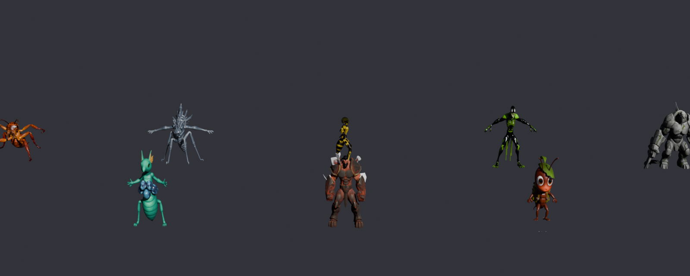

# Game 3D Asset Skills (Hermes Agent)

Text prompt → images → alpha-masked sprites → textured 3D GLBs → auto-rigged characters,
orchestrated end-to-end by Hermes Agent skills. Runs on Hugging Face ZeroGPU with your own
`HF_TOKEN` — no local GPU required for the 3D/rigging phases.

Built around two Hugging Face Spaces:
- [microsoft/TRELLIS.2](https://huggingface.co/spaces/microsoft/TRELLIS.2) — image → textured 3D GLB
- [VAST-AI/SkinTokens](https://huggingface.co/spaces/VAST-AI/SkinTokens) — static mesh → skeleton + skin weights (rigged GLB)

## The four skills



| Skill | Role | When it runs |
|---|---|---|
| `skills/game-asset-pipeline` | Orchestrator | "make me 10 enemy characters" — chains everything below |
| `skills/trellis-image-to-3d` | Phase: image → 3D | single/batch GLB generation, quality gates, engine presets |
| `skills/skintokens-rigging` | Phase: mesh → rig | single/batch auto-rigging with rig verification gates |
| `skills/puppeteer-animation` | Phase: rig → animation | video-guided animation of any rigged asset (local GPU) |

Each phase skill works standalone; the orchestrator invokes them as needed.

## Edit any stage

The chain is not a one-shot. `scripts/asset_stage.py` writes a `project.json`
ledger. Change the prompt, replace the concept PNG, fix the mask in GIMP, or
overwrite the GLB from Blender — `refresh` sees the new hash and `plan` prints
only the downstream commands.

| You change | What reruns |
|---|---|
| prompt (`set-prompt`) | image → mask → mesh → rig |
| concept image (regen, inpaint, or a painted PNG) | mask onward |
| alpha mask | mesh onward |
| mesh (Blender edit, export over the GLB, `refresh`) | rig onward |
| rig (weight-paint, re-export) | animation only |

```bash
python3 scripts/asset_stage.py adopt ./my-colony
python3 scripts/asset_stage.py set-prompt ./my-colony 01_fire_ant "new description"
python3 scripts/asset_stage.py refresh ./my-colony
python3 scripts/asset_stage.py plan ./my-colony --slug 01_fire_ant
python3 scripts/asset_stage.py run ./my-colony 01_fire_ant --through rig
```

Cost is your own inference: a Hugging Face token (ZeroGPU quota on the MIT-licensed
TRELLIS.2 and SkinTokens Spaces) or a local GPU (ComfyUI for images, Puppeteer
for animation). No per-generation paid API. Prompt files may contain `#`
comments; both the ledger and `trellis_gen.py` skip them.

## Animation phase (puppeteer-animation)

https://github.com/Jpalmer95/game-3d-asset-skills/raw/master/examples/fire_ant_walk.mp4

Rigged asset + a short AI-generated driving video → skeletal keyframes baked into
an animated GLB, via [Seed3D/Puppeteer](https://github.com/Seed3D/Puppeteer)
(video-guided motion optimization). Works on **any** skeleton — the clip above is
one of the SkinTokens-rigged ants learning a six-legged walk cycle from a
5-second image-to-video clip. Runs locally on a 12GB GPU (~25 min/animation);
see the skill's SKILL.md for the VRAM playbook. Our 12GB compatibility fixes are
also PRed upstream: https://github.com/Seed3D/Puppeteer/pull/26

## Install (Hermes Agent)

Share this repo. Do not make a fifth skill that only links here — the four
skills below are the installable units, and they go stale if a wrapper
restates them.

```bash
# searchable from `hermes skills search` after this
hermes skills tap add Jpalmer95/game-3d-asset-skills

# or install directly (identifier is owner/repo/path-to-skill-dir)
hermes skills install Jpalmer95/game-3d-asset-skills/skills/game-asset-pipeline
hermes skills install Jpalmer95/game-3d-asset-skills/skills/trellis-image-to-3d
hermes skills install Jpalmer95/game-3d-asset-skills/skills/skintokens-rigging
hermes skills install Jpalmer95/game-3d-asset-skills/skills/puppeteer-animation

# the ledger and the example prompts are NOT inside the skill folders
git clone https://github.com/Jpalmer95/game-3d-asset-skills.git
pip install "gradio_client>=1.0" "rembg[cpu]" pillow
export HF_TOKEN=hf_...   # read token: https://huggingface.co/settings/tokens
```

Start a new Hermes session (skills load at session start), then ask:
> "Generate 3 elemental ant enemies, rigged, for my Godot game. Vision-gate each image before 3D."

Start with 3, not 10. ZeroGPU is serial and a few minutes per asset per phase.
Their `HF_TOKEN` spends their quota, not yours.

Passing the repo link is enough. This README, `AGENTS.md`, and `LOCAL.md`
are what their agent should read. They do not need a walkthrough from you.

## Running it fully locally

No token, weights on their own GPU: **24 GB NVIDIA, Linux, one stage at a
time.** That is TRELLIS.2's published floor, and it also covers SkinTokens
(14 GB) and animation. A 16 GB card can rig and still cannot run official
TRELLIS.2. A 12 GB card (RTX 4070 Ti class) is the Space path plus local
images and patched Puppeteer — not a full local stack.

Full table, disk, RAM, and the separate-venv warning: [LOCAL.md](LOCAL.md).

## Quick start (manual, no agent)

```bash
T=~/.hermes/skills/gaming/trellis-image-to-3d/scripts/trellis_gen.py
R=~/.hermes/skills/gaming/skintokens-rigging/scripts/skintokens_rig.py

rembg i concept.png masked.png
python3 $T masked.png -o out.glb --target godot
python3 $R out.glb -o out_rigged.glb --preserve-texture-scale
```

See `examples/GUIDE.md` for the full workflow guide (prompt patterns, preprocessing
toolbox, Blender post-processing, versioning) and `examples/ant_elementals.txt` for a
ready 10-prompt batch.

## Features

- **Quality gates** (`pipeline_qgates.py`): alpha-mask coverage check, GLB parse +
  vertex/texture validation, rig joints + skin-weight verification. Bad inputs fail
  before burning GPU quota.
- **`--resume`**: crash-safe batch reruns — completed assets are skipped.
- **Engine presets** (`--target`): `godot-mobile` (30k faces/1k tex), `godot`/`unity`
  (80k/2k), `blender` (300k/2k), `film` (500k/4k).
- **Manifests**: per-run CSVs tracking prompt, seed, paths, and per-phase status.
- **Battle-tested**: built and debugged against the live Spaces (gradio_client 1.x
  `token=` auth, `handle_file()` inputs, list-valued rig outputs, numeric texture size).

## Notes & limitations

- ZeroGPU quota is per-HF-account and serialized — batches run sequentially, a few
  minutes per asset per phase.
- **`rembg` CLI is fragile**: its entrypoint eagerly imports server deps (gradio,
  aiohttp, fastapi). Use the Python API instead:
  `python3 -c "from rembg import remove; open('out.png','wb').write(remove(open('in.png','rb').read()))"`
- SkinTokens output includes a joint-visualization icosphere mesh; hide/delete it in
  Blender/Godot before shipping. Headless:
  `blender -b --python scripts/strip_icosphere.py -- in_rigged.glb out_rigged.glb`
- Auto-rigs are a starting point: thin appendages may need a weight-paint pass.
- Check `MODELS.md` before swapping a stage. TRELLIS.2 and SkinTokens are still
  the MIT defaults; a higher-quality model with a non-commercial license is not
  an upgrade for a pipeline other people will ship assets from.
- TRELLIS.2 is research code — the model and Space card are MIT, but confirm the
  model card before you sell generated assets.

## License

MIT (skills and scripts). The underlying Spaces/models carry their own licenses.
